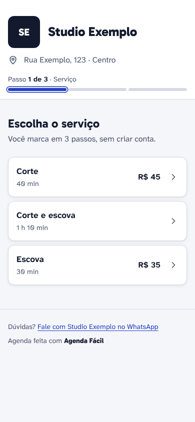
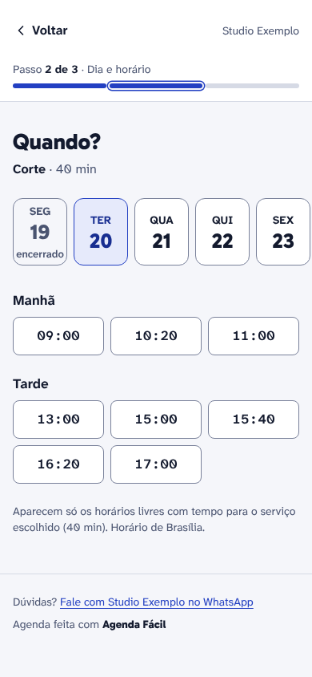
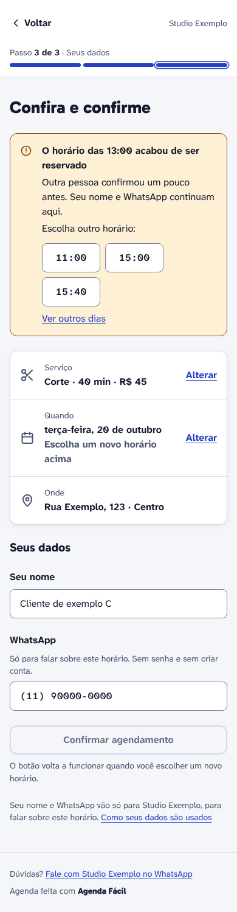
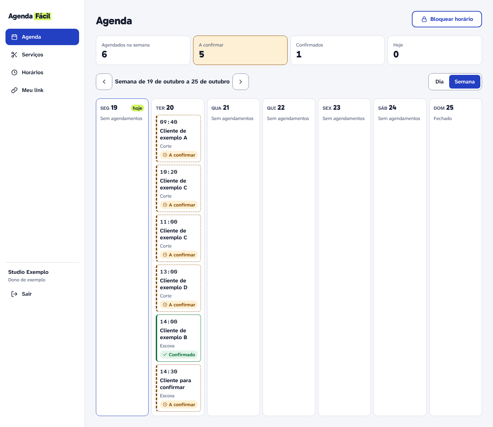
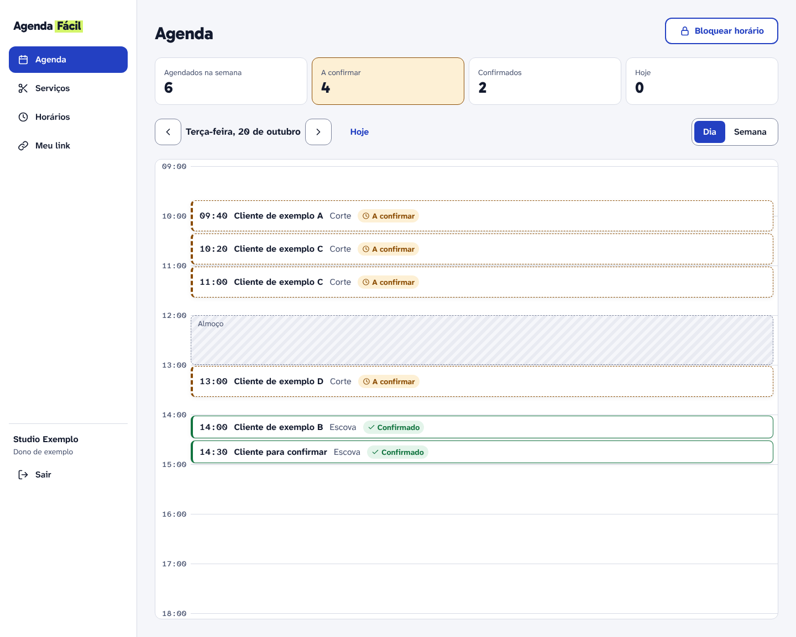
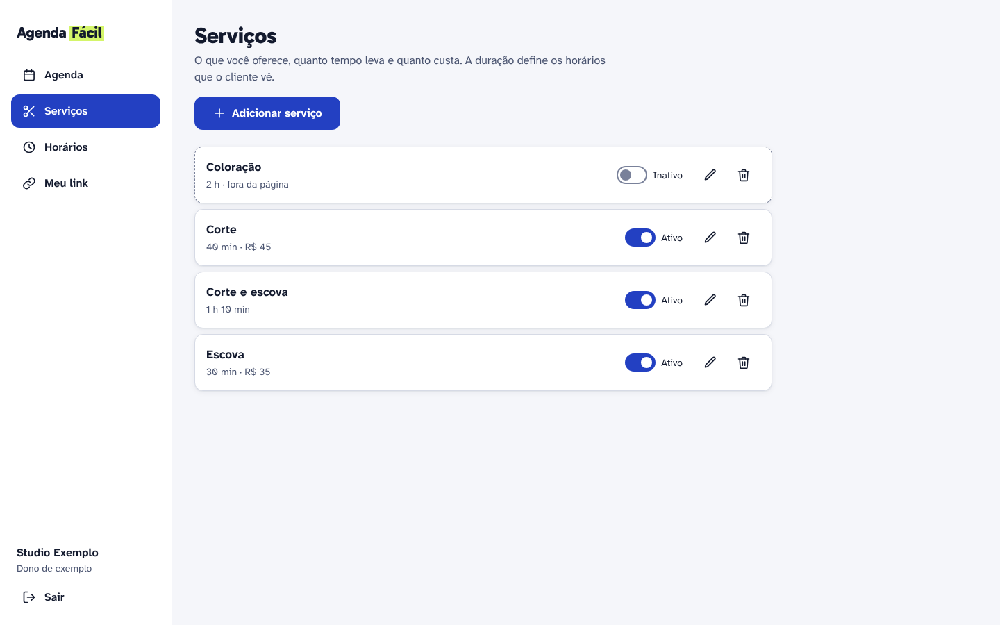
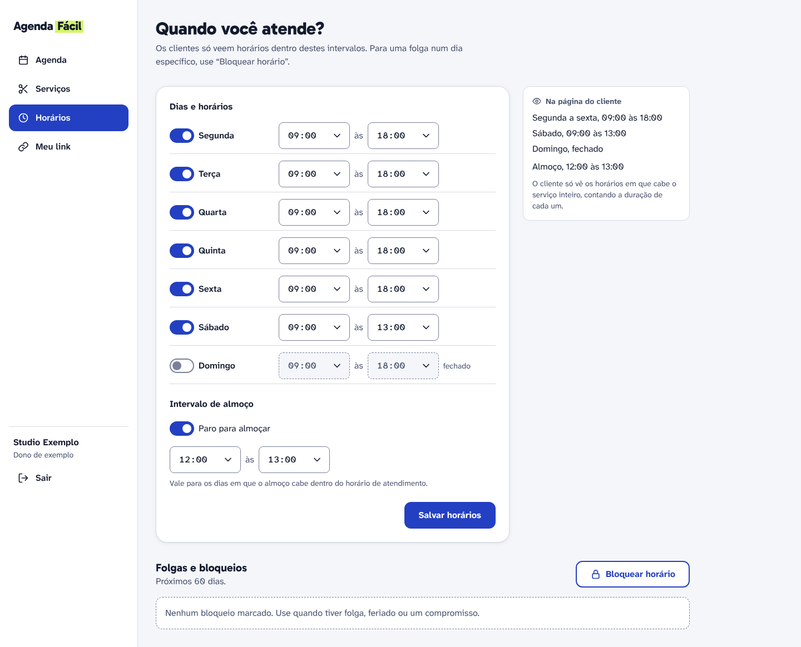
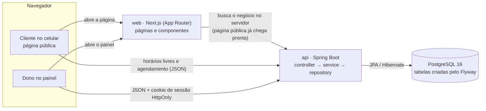
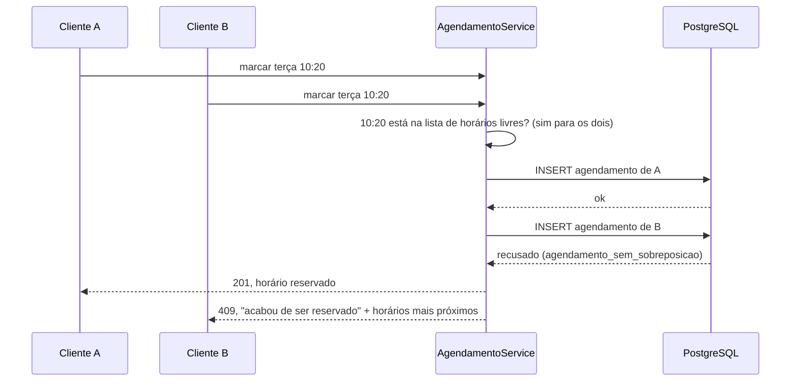
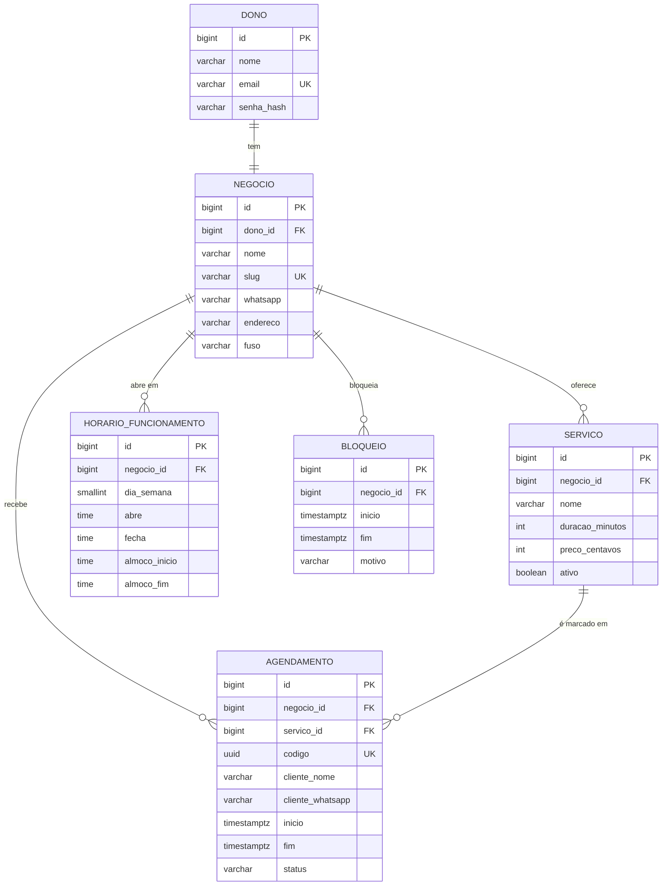

# Agenda Fácil

Agendamento online para pequenos negócios de serviço (salão, barbearia, estúdio, quadra). O dono cria a conta, cadastra serviços e horários e recebe um link público. O cliente final marca pelo celular, sem criar conta. O dono acompanha tudo num painel.

O projeto tem duas partes:

- **Parte 1, case de UX:** [design/README.md](design/README.md). Pesquisa (hipóteses), fluxos, wireframes, avaliação heurística, design system e [protótipo navegável](https://beatrizcampos-dev.github.io/agenda-facil/design/prototipo/). O arquivo do Figma está em [Agenda Fácil · Case UX](https://www.figma.com/design/KzXCAfLG2xE3x8FT3fQGRR).
- **Parte 2, produto full stack:** este README. A API é em Java com Spring Boot, o front em Next.js e o banco em PostgreSQL. Tudo roda no computador com Docker.

Autora: Beatriz Campos Alves · Código: [github.com/beatrizcampos-dev/agenda-facil](https://github.com/beatrizcampos-dev/agenda-facil)

<!-- TODO(Beatriz): conferir se o arquivo do Figma está na minha conta e tirar o "(Copy)" do nome. -->


---

## O que o produto faz

**Cliente (página pública `/{link-do-negócio}`, feita para celular)**

- Escolhe o serviço, depois o dia e um horário livre, e informa nome e WhatsApp. São 3 passos e não precisa de conta.
- Recebe a confirmação com o resumo, um arquivo `.ics` para salvar na agenda do celular e um botão "Avisar no WhatsApp" com a mensagem já escrita (link `wa.me`).
- Se outra pessoa confirma o mesmo horário um segundo antes, aparece um aviso com os horários livres mais próximos. Nome e WhatsApp continuam preenchidos.

**Dono (painel em `/painel`)**

- Faz o cadastro e o login com e-mail e senha e edita o perfil do negócio: nome, link único, WhatsApp e endereço opcional.
- Gerencia os serviços: nome, duração, preço opcional, ativo ou inativo.
- Configura os horários da semana, o intervalo de almoço e bloqueios pontuais (folga, consulta, feriado).
- Vê a agenda do dia (linha do tempo) e da semana, com um contador da semana: agendados, a confirmar, confirmados e hoje.
- Confirma ou cancela agendamentos e pede confirmação ao cliente pelo WhatsApp.
- Todas as telas têm estado de carregando, vazio e erro.

**Regras que ficam no servidor (o front nunca decide disponibilidade)**

- Os horários livres são calculados pela API: expediente menos almoço, agendamentos, bloqueios e o que já passou.
- Dois clientes nunca ficam com o mesmo horário. Há uma checagem no service e uma regra no próprio banco (*exclusion constraint* do PostgreSQL), que vale mesmo quando duas pessoas confirmam no mesmo instante.
- Não dá para marcar no passado, fora do horário de atendimento ou fora da grade do serviço.

| Cliente no celular (390 px) | | |
|---|---|---|
|  |  |  |

| Painel do dono (1440 px) | |
|---|---|
|  |  |
|  |  |

Todas as telas estão em [docs/screens/](docs/screens/). Elas são geradas pelos testes de ponta a ponta (Playwright) a cada execução.

---

## Arquitetura



- **web/** só mostra dados e coleta escolhas. A página pública é renderizada no servidor do Next (o nome do negócio e os serviços chegam no HTML) e o resto do fluxo roda no navegador.
- **api/** concentra as regras. Cada pacote (`auth`, `negocio`, `servico`, `horario`, `bloqueio`, `agendamento`) tem controller (HTTP), service (regra de negócio) e repository (banco). Entram e saem DTOs em `record`, e os erros saem num formato padrão ([ProblemDetail, RFC 9457](https://www.rfc-editor.org/rfc/rfc9457)).
- **Login do dono:** a senha é guardada com BCrypt. O login gera um JWT assinado que vai num cookie `HttpOnly` e `SameSite=Lax`, e o Spring Security valida o token em toda rota do painel.

### Como a API impede dois clientes no mesmo horário



### Banco de dados



O esquema completo, com as regras de cada coluna, está em [V1__esquema_inicial.sql](api/src/main/resources/db/migration/V1__esquema_inicial.sql). Os horários são gravados em UTC (`timestamptz`) e mostrados no fuso do negócio (`America/Sao_Paulo`).

### Estrutura de pastas

```
agenda-facil/
├── design/              Parte 1: case de UX e protótipo (não muda na Parte 2)
├── api/                 Spring Boot (Java 21, Maven)
│   └── src/main/java/com/agendafacil/
│       ├── auth/        cadastro, login, JWT no cookie
│       ├── negocio/     perfil do negócio e link (slug)
│       ├── servico/     CRUD de serviços
│       ├── horario/     horários da semana
│       ├── bloqueio/    folgas e bloqueios pontuais
│       ├── agendamento/ cálculo de horários livres, agendamento público, agenda do painel, .ics
│       ├── seguranca/   limite de tentativas, limpeza de textos
│       ├── erro/        exceções e respostas de erro padronizadas
│       └── config/      Spring Security, CORS, Swagger, dados de exemplo (perfil dev)
├── web/                 Next.js (App Router, TypeScript, Tailwind)
│   ├── src/app/         rotas: /, /entrar, /cadastro, /painel/*, /[slug], /[slug]/confirmado/[codigo]
│   ├── src/componentes/ componentes do design system, página pública e painel
│   ├── src/lib/         cliente da API tipado, formatação, validação (Zod)
│   └── e2e/             testes de ponta a ponta (Playwright) e de acessibilidade (axe)
├── docs/screens/        prints e GIF gerados pelos testes
├── docker-compose.yml   PostgreSQL 16
└── .env.example         modelo das configurações (o .env de verdade não vai para o Git)
```

---

## Tecnologias

| Parte | O que usa |
|---|---|
| API | Java 21, Spring Boot 3.5 (Web, Data JPA, Validation, Security, OAuth2 Resource Server para o JWT), PostgreSQL 16, Flyway, BCrypt, springdoc-openapi (Swagger) |
| Web | Next.js 16 (App Router), React 19, TypeScript estrito, Tailwind CSS 4 com os tokens da Parte 1, React Hook Form + Zod |
| Testes | JUnit 5, Mockito, MockMvc, Testcontainers (API) · Vitest + Testing Library, Playwright, axe-core (web) |
| Infra local | Docker Compose |

---

## Como rodar

Você precisa de: **Docker Desktop**, **Java 21 (JDK)** e **Node.js 20 ou mais novo**. Não precisa instalar Maven: o projeto traz o `mvnw`.

**1. Baixar o projeto e criar o `.env`**

```bash
git clone https://github.com/beatrizcampos-dev/agenda-facil.git
cd agenda-facil
cp .env.example .env        # no Windows (cmd): copy .env.example .env
```

Abra o `.env` e troque dois valores:

- `POSTGRES_PASSWORD`: qualquer senha para o banco local.
- `JWT_SEGREDO`: um texto aleatório com pelo menos 32 caracteres. Para gerar um, use `openssl rand -base64 48` (Git Bash, macOS, Linux) ou, no PowerShell, `[Convert]::ToBase64String([Security.Cryptography.RandomNumberGenerator]::GetBytes(48))`.

**2. Subir o banco**

```bash
docker compose up -d
```

**3. Subir a API** (em http://localhost:8080)

```bash
cd api
./mvnw spring-boot:run -Dspring-boot.run.profiles=dev
# no Windows: mvnw.cmd spring-boot:run -Dspring-boot.run.profiles=dev
```

Na primeira vez, o Flyway cria as tabelas. O perfil `dev` cria um negócio de exemplo, o **Studio Exemplo**, com serviços e dois agendamentos, todos fictícios. A documentação da API abre em **http://localhost:8080/swagger-ui**.

**4. Subir o front** (em outro terminal, http://localhost:3000)

```bash
cd web
cp .env.example .env.local   # no Windows: copy .env.example .env.local
npm install
npm run dev
```

**5. Usar**

- Página do cliente: http://localhost:3000/studio-exemplo
- Painel do dono: http://localhost:3000/entrar, com `dono@example.com` e senha `senha-de-exemplo-123` (só existem no perfil `dev`)
- Para começar do zero, crie uma conta em http://localhost:3000/cadastro.

### Rodar os testes

```bash
# API: testes de unidade (Mockito) e de integração (MockMvc + PostgreSQL de verdade com Testcontainers)
cd api
./mvnw test          # com o Docker aberto; sem Docker, os testes de integração são pulados

# Web: lint, testes de componente e build
cd web
npm run lint
npm test
npm run build

# Web: ponta a ponta no navegador (com o banco e a API no perfil dev rodando)
npx playwright install chromium   # só na primeira vez
npm run test:e2e
```

O que os testes cobrem:

- **Cálculo de horários livres:** grade pela duração, almoço, passado, sobreposição e fechamento.
- **Conflito de horário:** checagem no service, recusa pelo banco e duas pessoas confirmando ao mesmo tempo (só uma consegue).
- **Segurança:** horário de atendimento, rotas protegidas, um dono não alcança dados de outro (404), limite de tentativas no login e no agendamento, CORS.
- **Formulários:** seletor de horários e formulário de agendamento (validação, máscara, erro vindo do servidor).
- **Navegador:** fluxo completo do cliente a 390 px, login e painel do dono a 1440 px, e o axe (WCAG 2.1 AA) em todas as telas.

### Lighthouse da página pública

Medido em 19/10/2026, no computador local, com o build de produção. Mediana de 3 execuções.

| | Desempenho | Acessibilidade | Boas práticas | SEO |
|---|---|---|---|---|
| Celular | 95 | 100 | 100 | 91 |
| Computador | 100 | 100 | 100 | 91 |

O SEO perde pontos num item: o Next 16 envia a descrição da página depois do primeiro HTML (*streaming metadata*), e o Lighthouse só procura no `<head>`. O Google lê a descrição normalmente.

---

## Decisões técnicas

1. **O servidor calcula os horários livres; o front só mostra.** Se a regra ficasse no navegador, bastaria mudar uma requisição para marcar em cima de outro cliente.
2. **Duas barreiras contra horário duplicado.** A checagem no service dá uma resposta clara (409, com sugestões). A regra `EXCLUDE USING gist` no PostgreSQL garante que, mesmo em corrida, só um agendamento entra. Cancelado não ocupa horário.
3. **JWT em cookie HttpOnly, não em `localStorage`.** Um script malicioso na página não consegue ler o token. O CORS só aceita o endereço do front e o cookie usa `SameSite=Lax`.
4. **Os horários andam pela duração do serviço**, como no protótipo: corte de 40 min mostra 09:00, 09:40, 10:20… e recomeça depois do almoço.
5. **Cada dono só alcança o que é seu.** Toda busca do painel parte do id que está no token (`findByIdAndNegocioId`). O recurso de outro negócio responde 404, igual a um que não existe.
6. **O cliente não tem conta.** Nome e WhatsApp bastam. A página de confirmação usa um código aleatório (UUID) no lugar do id.
7. **Front sem biblioteca extra de estado ou de busca de dados.** Um hook simples (`useBusca`) entrega carregando, erro e dados. O formulário do cliente só é baixado no passo 3, o que deixa a primeira tela mais leve no celular.

---

## Plano de deploy (documentado, ainda não feito)

<!-- TODO(Beatriz): criar as contas no Render e na Vercel e, se possível, comprar um domínio. -->

| Parte | Onde | Como |
|---|---|---|
| Banco | Render PostgreSQL | Copiar a URL de conexão para as variáveis da API. |
| API | Render (Web Service) | Build: `./mvnw -DskipTests package`. Start: `java -jar target/agenda-facil-api-0.1.0.jar`. Variáveis: `SPRING_PROFILES_ACTIVE=prod`, `DB_URL`, `POSTGRES_USER`, `POSTGRES_PASSWORD`, `JWT_SEGREDO`, `CORS_ORIGENS`, `COOKIE_DOMINIO`. |
| Web | Vercel | Pasta raiz `web/`. Variáveis: `NEXT_PUBLIC_API_URL` e `NEXT_PUBLIC_SITE_URL`. |

Cuidados:

- **Domínio.** `vercel.app` e `onrender.com` são sites diferentes para o navegador, e o cookie de sessão (`SameSite=Lax`) não iria junto nas chamadas. O caminho mais simples é um domínio próprio com `app.seudominio.com.br` (Vercel) e `api.seudominio.com.br` (Render), e `COOKIE_DOMINIO=seudominio.com.br`.
- **IP do cliente.** O perfil `prod` liga `forward-headers-strategy`, para o limite de tentativas usar o IP real que vem do proxy.
- **Limite de tentativas.** Fica em memória: serve para uma instância da API. Com mais de uma, os contadores precisariam ir para um lugar compartilhado (Redis, por exemplo).

O protótipo da Parte 1 já está no GitHub Pages (é só HTML estático). O produto da Parte 2 ainda não tem deploy.

---

## Próximos passos

- Pagamento antecipado ou sinal na hora de marcar.
- Vários profissionais no mesmo negócio (o protótipo já desenha a escolha "com quem").
- Lembretes automáticos por WhatsApp ou e-mail antes do horário.
- Cliente remarcar ou cancelar pelo link da confirmação.
- Recuperar senha por e-mail e confirmar o e-mail no cadastro.
- Política de privacidade e LGPD: por quanto tempo guardar o nome e o WhatsApp do cliente.
- Tema escuro (os tokens da Parte 1 só têm o tema claro).

## O que aprendi

<!-- TODO(Beatriz): escrever com as suas palavras o que aprendeu construindo a Parte 2. -->

---

Studio Exemplo, os clientes de exemplo, os telefones (`00900000000`), o endereço e os preços são dados fictícios, criados só para testar as telas. Fontes: Gabarito e Atkinson Hyperlegible Next e Mono (SIL Open Font License). Ícones no estilo Feather (MIT) e Lucide (ISC). O estudo de cada parte do código está em [ESTUDO.md](ESTUDO.md).
