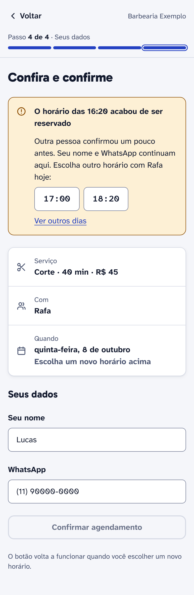
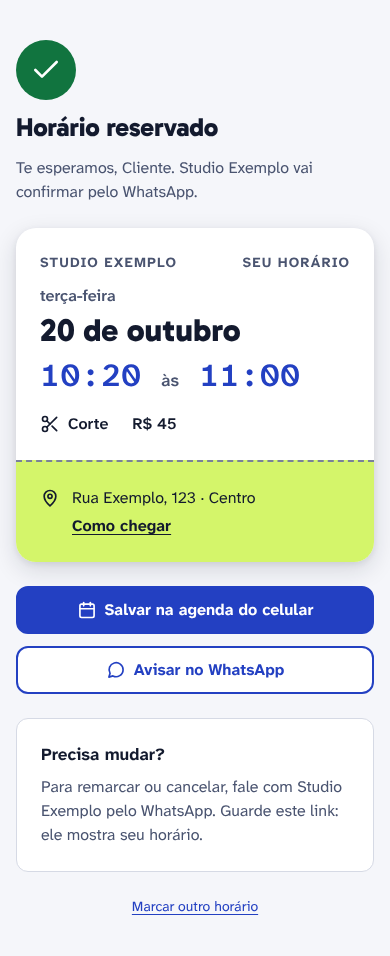
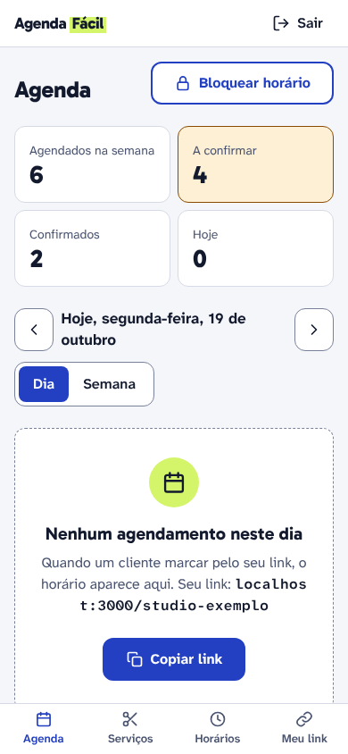
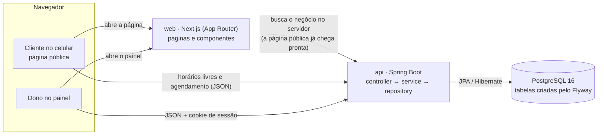
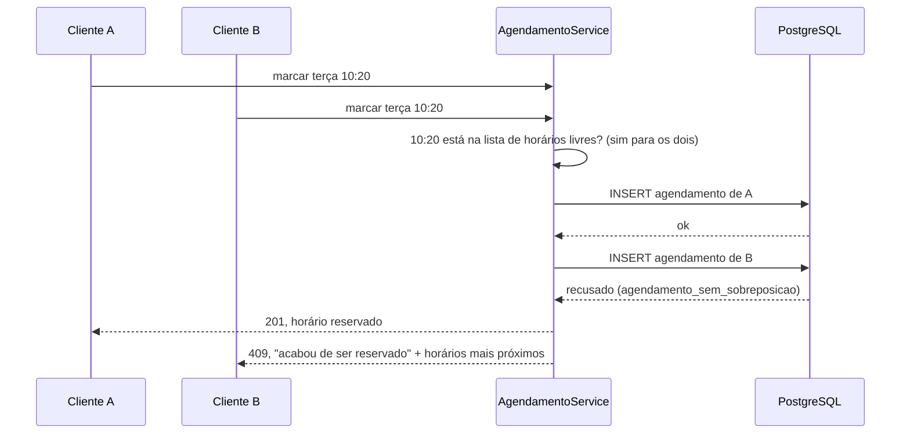
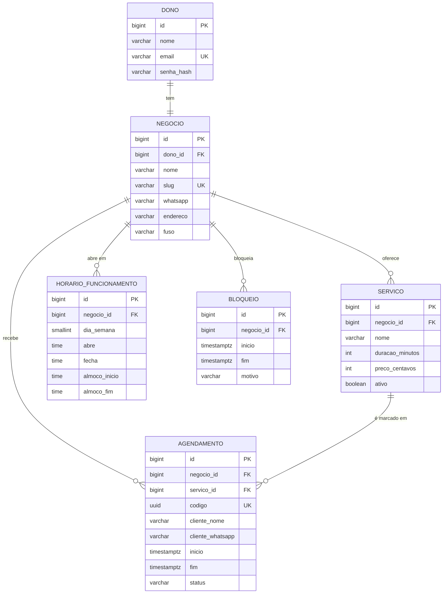

# Agenda Fácil

[](https://github.com/beatrizcampos-dev/agenda-facil/actions/workflows/testes.yml)

Agendamento online para pequenos negócios de serviço (salão, barbearia, estúdio, quadra). O dono cria a conta, cadastra serviços e horários e recebe um link para divulgar. O cliente marca pelo celular, sem criar conta. O dono acompanha tudo num painel.

É um projeto pessoal de portfólio, feito em duas partes:

- **Parte 1, o case de UX:** [design/README.md](design/README.md). Hipóteses de pesquisa, fluxos, wireframes, avaliação heurística, design system e um [protótipo navegável](https://beatrizcampos-dev.github.io/agenda-facil/design/prototipo/). O Figma está em [Agenda Fácil · Case UX](https://www.figma.com/design/KzXCAfLG2xE3x8FT3fQGRR).
- **Parte 2, o produto funcionando:** este README. API em Java com Spring Boot, site em Next.js e banco PostgreSQL, rodando no computador.

Autora: Beatriz Campos Alves · Código: [github.com/beatrizcampos-dev/agenda-facil](https://github.com/beatrizcampos-dev/agenda-facil)

<!-- TODO(Beatriz): conferir se o arquivo do Figma está na minha conta e tirar o "(Copy)" do nome. -->


### Do protótipo ao produto

Na Parte 1, a tela de quem perde a disputa por um horário foi desenhada no protótipo. Na Parte 2, essa regra virou código e banco de dados, e a tela é a mesma:

| Protótipo (Parte 1) | Produto (Parte 2) |
|---|---|
|  |  |

As cores, as fontes e os espaçamentos também são os mesmos nos três lugares: as variáveis do Figma, o `tokens.css` do protótipo e o tema do Tailwind no site.

---

## O que o produto faz

**Cliente (página pública `/{link-do-negócio}`, feita para celular)**

- Escolhe o serviço, o dia e um horário livre e informa nome e WhatsApp. São 3 passos e não precisa de conta.
- Recebe a confirmação com o resumo, um arquivo `.ics` para salvar na agenda do celular e um botão "Avisar no WhatsApp" com a mensagem já escrita (link `wa.me`).
- Se outra pessoa confirma o mesmo horário um segundo antes, aparece um aviso com os horários livres mais próximos. Nome e WhatsApp continuam preenchidos.
- O link da confirmação mostra se o horário continua reservado, foi confirmado ou foi cancelado pelo negócio.
- Há uma página curta explicando [como os dados são usados](web/src/app/privacidade/page.tsx).

**Dono (painel em `/painel`, funciona no computador e no celular)**

- Faz o cadastro e o login com e-mail e senha e edita o perfil do negócio: nome, endereço do link, WhatsApp e endereço opcional.
- Cadastra serviços com nome, duração e preço opcional, e ativa ou desativa cada um.
- Configura os horários da semana, o intervalo de almoço e bloqueios pontuais (folga, consulta, feriado).
- Vê a agenda do dia (linha do tempo) e da semana, com um contador da semana: agendados, a confirmar, confirmados e hoje.
- Confirma ou cancela agendamentos e fala com o cliente pelo WhatsApp com a mensagem pronta.
- Todas as telas têm estado de carregando, vazio e erro.

**Regras que ficam na API (o site nunca decide se um horário está livre)**

- Os horários livres são calculados pela API: expediente, menos almoço, agendamentos, bloqueios e o que já passou.
- Dois clientes nunca ficam com o mesmo horário. A API confere antes de gravar, e o próprio banco recusa dois agendamentos sobrepostos, mesmo quando duas pessoas confirmam no mesmo instante.
- Não dá para marcar no passado, fora do horário de atendimento ou num horário que não existe na grade do serviço.

| Cliente no celular (390 px) | | |
|---|---|---|
|  |  |  |

| Painel do dono (1440 px) | | Celular |
|---|---|---|
|  |  |  |

Todas as telas estão em [docs/screens/](docs/screens/). Elas são geradas pelos testes automáticos de navegador (Playwright) a cada execução.

---

## Decisões técnicas

1. **A API calcula os horários livres e o site só mostra.** Se a regra ficasse no navegador, bastaria alterar uma requisição para marcar em cima de outro cliente.
2. **Duas barreiras contra horário duplicado.** A API confere a lista de horários livres e responde 409 (conflito) com sugestões. No banco, uma regra do PostgreSQL (`EXCLUDE USING gist`, uma restrição que proíbe faixas de horário sobrepostas no mesmo negócio) garante que, mesmo em corrida, só um agendamento entra. Agendamento cancelado não ocupa horário.
3. **Login com token num cookie protegido.** A senha é guardada com BCrypt (um resumo que não dá para reverter). O login gera um token JWT assinado, que vai num cookie `HttpOnly` (o JavaScript da página não consegue ler) e `SameSite=Lax` (outro site não consegue usar). Só o endereço do site pode chamar a API pelo navegador (CORS).
4. **Os horários andam pela duração do serviço**, como no protótipo: um corte de 40 min mostra 09:00, 09:40, 10:20… e recomeça depois do almoço. É simples de entender e de testar; o custo está em "Limitações conhecidas".
5. **Cada dono só alcança o que é seu.** Toda busca do painel parte do id que está no token. O agendamento de outro negócio responde 404, igual a um que não existe.
6. **O cliente não tem conta.** Nome e WhatsApp bastam. A página de confirmação usa um código aleatório (UUID) no lugar do número do agendamento, para ninguém adivinhar o link de outra pessoa.
7. **Limite de tentativas** no login, no cadastro e no agendamento, para dificultar robôs e força bruta.
8. **Site sem biblioteca extra de estado.** Um hook simples (`useBusca`) entrega carregando, erro e dados. O formulário do cliente só é baixado no passo 3, e a primeira tela fica mais leve no celular.

---

## Arquitetura



- **web/** mostra dados e coleta escolhas. A página pública é montada no servidor do Next (o nome do negócio e os serviços chegam prontos no HTML) e o resto do fluxo roda no navegador.
- **api/** concentra as regras. Cada pacote (`auth`, `negocio`, `servico`, `horario`, `bloqueio`, `agendamento`) tem três camadas: controller (recebe o HTTP), service (regra de negócio) e repository (banco). Os dados entram e saem em objetos próprios (DTOs, em `record` do Java), e os erros saem sempre no mesmo formato JSON ([ProblemDetail](https://www.rfc-editor.org/rfc/rfc9457)).
- **Banco:** as tabelas são criadas e versionadas pelo Flyway, que roda os arquivos SQL de `api/src/main/resources/db/migration/` em ordem.

### Como a API impede dois clientes no mesmo horário



### Banco de dados



`slug` é o pedaço do link que identifica o negócio (`studio-exemplo`). Os horários são gravados em UTC (`timestamptz`) e mostrados no fuso do negócio (`America/Sao_Paulo`). O esquema completo, com as regras de cada coluna, está em [V1__esquema_inicial.sql](api/src/main/resources/db/migration/V1__esquema_inicial.sql).

### Estrutura de pastas

```
agenda-facil/
├── design/              Parte 1: case de UX e protótipo
├── api/                 Spring Boot (Java 21, Maven)
│   └── src/main/java/com/agendafacil/
│       ├── auth/        cadastro, login, token no cookie
│       ├── negocio/     perfil do negócio e endereço do link
│       ├── servico/     serviços
│       ├── horario/     horários da semana
│       ├── bloqueio/    folgas e bloqueios pontuais
│       ├── agendamento/ cálculo de horários livres, agendamento do cliente, agenda do painel, .ics
│       ├── seguranca/   limite de tentativas, limpeza de textos
│       ├── erro/        exceções e respostas de erro padronizadas
│       └── config/      Spring Security, CORS, Swagger, dados de exemplo (perfil dev)
├── web/                 Next.js (App Router, TypeScript, Tailwind)
│   ├── src/app/         rotas: /, /entrar, /cadastro, /painel/*, /[slug], /[slug]/confirmado/[codigo], /privacidade
│   ├── src/componentes/ componentes do design system, página pública e painel
│   ├── src/lib/         cliente da API, formatação, validação dos formulários (Zod)
│   └── e2e/             testes de navegador (Playwright) e de acessibilidade (axe)
├── docs/screens/        prints e GIF gerados pelos testes
├── .github/workflows/   testes automáticos a cada push
├── docker-compose.yml   PostgreSQL 16
└── .env.example         modelo das configurações (o .env de verdade não vai para o Git)
```

---

## Tecnologias

| Parte | O que usa |
|---|---|
| API | Java 21, Spring Boot 3.5 (Web, Data JPA, Validation, Security, OAuth2 Resource Server para o JWT), PostgreSQL 16, Flyway, BCrypt, springdoc-openapi (Swagger) |
| Site | Next.js 16 (App Router), React 19, TypeScript estrito, Tailwind CSS 4 com os tokens da Parte 1, React Hook Form + Zod |
| Testes | JUnit 5, Mockito, MockMvc, Testcontainers (API) · Vitest + Testing Library, Playwright, axe-core (site) · GitHub Actions |
| Ambiente local | Docker Compose (só o banco) |

---

## Como rodar

O banco roda no Docker. A API e o site rodam direto no computador, então você precisa de:

- **Docker Desktop** (no Windows ele pede o WSL2 e uma reinicialização na primeira instalação);
- **Java 21**: confira com `java -version`. Se aparecer outra versão, instale o JDK 21 e ajuste o `JAVA_HOME`;
- **Node.js 22**: confira com `node -v`.

Não precisa instalar o Maven: o projeto traz o `mvnw`. Se você já tem um PostgreSQL instalado usando a porta 5432, pare ele antes (ou troque a porta no `docker-compose.yml` e no `DB_URL`).

**1. Baixar o projeto e criar o `.env`**

```bash
git clone https://github.com/beatrizcampos-dev/agenda-facil.git
cd agenda-facil
cp .env.example .env         # no Windows (PowerShell ou cmd): copy .env.example .env
```

Abra o `.env` e troque dois valores. A API não sobe com os valores de exemplo:

- `POSTGRES_PASSWORD`: qualquer senha para o banco local.
- `JWT_SEGREDO`: um texto aleatório com pelo menos 32 caracteres. Para gerar, use `openssl rand -base64 48` (Git Bash, macOS, Linux) ou, no PowerShell, `[Convert]::ToBase64String([Security.Cryptography.RandomNumberGenerator]::GetBytes(48))`.

**2. Subir o banco** (o `--wait` espera o banco ficar pronto)

```bash
docker compose up -d --wait
```

**3. Subir a API** (em http://localhost:8080)

```bash
cd api
./mvnw spring-boot:run -Dspring-boot.run.profiles=dev
```

No Windows, na pasta `api`:

```powershell
# PowerShell
.\mvnw.cmd spring-boot:run "-Dspring-boot.run.profiles=dev"
# cmd
mvnw.cmd spring-boot:run -Dspring-boot.run.profiles=dev
```

Na primeira vez, o Flyway cria as tabelas. O perfil `dev` cria um negócio de exemplo, o **Studio Exemplo**, com serviços e dois agendamentos, todos fictícios. A documentação da API abre em **http://localhost:8080/swagger-ui**.

**4. Subir o site** (abra outro terminal na pasta `agenda-facil`; o site fica em http://localhost:3000)

```bash
cd web
cp .env.example .env.local   # no Windows: copy .env.example .env.local
npm install
npm run dev
```

**5. Usar**

- Página do cliente: http://localhost:3000/studio-exemplo
- Painel do dono: http://localhost:3000/entrar, com `dono@example.com` e senha `senha-de-exemplo-123` (só existem no perfil `dev`).
- Para começar do zero, crie uma conta em http://localhost:3000/cadastro.

### Rodar os testes

```bash
# API, na pasta api: testes de unidade e de integração (com o Docker aberto;
# sem Docker, os de integração são pulados)
./mvnw test                  # Windows: .\mvnw.cmd test

# Site, na pasta web: lint, testes de componente e build
npm run lint
npm test
npm run build

# Site, testes de navegador: precisam do banco e da API no perfil dev rodando,
# e do build acima (eles sobem o site com npm run start)
npx playwright install chromium   # só na primeira vez
npm run test:e2e
```

O que os testes cobrem:

- **Horários livres:** a grade pela duração, o almoço, o que já passou, a sobreposição e o fechamento.
- **Conflito de horário:** a checagem na API, a recusa pelo banco e duas pessoas confirmando ao mesmo tempo (só uma consegue).
- **Segurança:** rotas protegidas, um dono não alcança dados de outro, limite de tentativas no login, no cadastro e no agendamento, CORS e o segredo de exemplo recusado.
- **Formulários:** seletor de horários e formulário de agendamento (validação, máscara do WhatsApp, erro vindo do servidor).
- **Navegador:** o fluxo completo do cliente a 390 px; o login, o painel e o cancelamento visto pelo cliente a 1440 px; o painel no celular; e o axe, que confere as regras de acessibilidade WCAG 2.1 AA, em todas as telas.

No GitHub, os testes da API e o lint, os testes e o build do site rodam a cada push ([.github/workflows/testes.yml](.github/workflows/testes.yml)).

### Lighthouse da página pública

O Lighthouse é a ferramenta do Google que dá notas de 0 a 100 para desempenho, acessibilidade, boas práticas e SEO. As notas abaixo foram medidas em 19/10/2026, no computador local, com o build de produção. Cada uma é a mediana de 3 execuções.

| | Desempenho | Acessibilidade | Boas práticas | SEO |
|---|---|---|---|---|
| Celular | 98 | 100 | 100 | 91 |
| Computador | 100 | 100 | 100 | 91 |

O SEO perde pontos num item: o Next 16 envia a descrição da página logo depois do primeiro pedaço do HTML (*streaming metadata*), e o Lighthouse só procura a descrição no começo da página. O Google lê a descrição normalmente.

---

## Limitações conhecidas

- **Bloqueio e agendamento ao mesmo tempo.** O banco garante que dois agendamentos não se sobrepõem, mas não cobre agendamento contra bloqueio. Se o dono bloquear um horário no mesmo instante em que um cliente marca, os dois podem entrar. A correção seria travar o negócio no banco durante a gravação (`SELECT ... FOR UPDATE`).
- **A grade pela duração deixa buracos.** Cada serviço tem a sua grade. Um corte de 40 min às 09:40 tira 09:00 e 10:00 da grade de um serviço de 60 min, mesmo havendo 40 minutos livres antes. Uma grade fixa de 15 em 15 minutos aproveitaria melhor o dia.
- **Limite de tentativas em memória.** Funciona com uma instância da API. Com mais de uma, os contadores precisariam ficar num lugar compartilhado (Redis, por exemplo).
- **O cadastro diz se o e-mail já tem conta.** É de propósito, para quem esqueceu que já se cadastrou; o limite de 10 tentativas por hora impede usar isso em massa. O login responde igual para e-mail inexistente e senha errada.
- **Sem notificação.** O dono só vê um agendamento novo quando abre o painel, e a confirmação para o cliente é feita pelo WhatsApp, com a mensagem pronta.
- **Fuso fixo.** O banco guarda um fuso por negócio, mas o painel ainda não deixa mudar: todos usam `America/Sao_Paulo`.

---

## Plano de deploy (documentado, ainda não feito)

<!-- TODO(Beatriz): criar as contas no Render e na Vercel e, se possível, comprar um domínio. -->

| Parte | Onde | Como |
|---|---|---|
| Banco | Render PostgreSQL | Copiar a URL de conexão para as variáveis da API. |
| API | Render (Web Service) | Build: `./mvnw -DskipTests package`. Start: `java -jar target/agenda-facil-api-0.1.0.jar`. Variáveis: `SPRING_PROFILES_ACTIVE=prod`, `DB_URL`, `POSTGRES_USER`, `POSTGRES_PASSWORD`, `JWT_SEGREDO`, `CORS_ORIGENS`, `COOKIE_DOMINIO`. |
| Site | Vercel | Pasta raiz `web/`. Variáveis: `NEXT_PUBLIC_API_URL` e `NEXT_PUBLIC_SITE_URL`. |

Cuidados:

- **Domínio.** `vercel.app` e `onrender.com` são sites diferentes para o navegador, e o cookie de sessão (`SameSite=Lax`) não iria junto nas chamadas. O caminho mais simples é um domínio próprio com `app.seudominio.com.br` (Vercel) e `api.seudominio.com.br` (Render), e `COOKIE_DOMINIO=seudominio.com.br`.
- **Perfil `prod`.** Liga o cookie só por HTTPS, desliga o Swagger e usa o IP real do cliente que vem do proxy da hospedagem (conferir, no deploy, se o proxy está na faixa que o Tomcat aceita como interna).

O protótipo da Parte 1 está no GitHub Pages porque é só HTML estático. O produto da Parte 2 ainda não tem deploy.

---

## Próximos passos

- Pagamento antecipado ou sinal na hora de marcar.
- Vários profissionais no mesmo negócio (o protótipo já desenha a escolha "com quem").
- Lembretes automáticos por WhatsApp ou e-mail antes do horário.
- Cliente remarcar ou cancelar pelo link da confirmação.
- Recuperar senha por e-mail e confirmar o e-mail no cadastro.
- Política de privacidade revisada e prazo para apagar agendamentos antigos (LGPD).
- Tema escuro (os tokens da Parte 1 só têm o tema claro).

<!-- TODO(Beatriz): escrever com as suas palavras o que aprendeu construindo a Parte 2 e trocar este comentário pela seção abaixo.
## O que aprendi
-->

---

Studio Exemplo, os clientes de exemplo, os telefones (`00900000000`), o endereço e os preços são dados fictícios, criados só para testar as telas. Fontes: Gabarito e Atkinson Hyperlegible Next e Mono (SIL Open Font License). Ícones no estilo Feather (MIT) e Lucide (ISC). Como cada parte do código funciona: [ESTUDO.md](ESTUDO.md).
